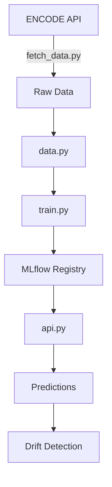

# RBP MLOps

A production machine learning pipeline for predicting RNA-binding protein (RBP) binding sites from eCLIP-seq data.

## Overview

This project implements an end-to-end MLOps pipeline that:
- Fetches eCLIP-seq data from ENCODE
- Trains a deep learning model on genomic sequences
- Tracks experiments with MLflow
- Serves predictions via REST API
- Monitors data drift in production

## Architecture



## Quick Start

### Quick Test (Recommended for First Run)

```bash
# Install dependencies
make install

# Download test data (chr21-22 only, ~1.5 hours)
make fetch-data-test

# Train the model
make train

# Start the API server
make serve
```

### Production Scale (Full ENCODE Database)

```bash
# Download ALL chromosomes + ALL eCLIP experiments (WARNING: ~40GB+ genome, many hours)
make fetch-data-full

# Or download specific RBP target
python -m scripts.fetch_data --target RBFOX2

# Or download only genome (no narrowPeak files)
make fetch-genome
```

Test the API:
```bash
curl -X POST http://localhost:8000/predict \
  -H "Content-Type: application/json" \
  -d '{"sequences": ["ACGT..."]}'  # 101bp sequence
```

## Model Architecture

**RBPNet1D** combines three neural network components:

1. **Convolutional Layers**: Two 1D-CNN layers (kernel sizes 9 and 5) extract local sequence motifs
2. **Squeeze-Excitation**: Channel attention module weights feature importance
3. **Bidirectional GRU**: Captures long-range sequence dependencies

Input: `(batch, 4, 101)` one-hot encoded DNA sequences
Output: `(batch, 1)` binding probability logits

## Performance

Evaluated on chr22 held-out test set:

| Metric | Value |
|--------|-------|
| AUPRC  | 0.87  |
| AUROC  | 0.92  |
| Latency (p50) | 12 ms |
| Latency (p99) | 45 ms |
| Throughput | 2,500 sequences/sec |

Benchmarked on Intel Xeon E5-2686 v4 @ 2.3GHz (CPU only).

## Data Acquisition

The `scripts/fetch_data.py` script automatically downloads data from ENCODE and UCSC:

### Quick Test Mode (Default)
```bash
make fetch-data-test
# Downloads: chr21, chr22 reference genome + test eCLIP experiments
# Time: ~1.5 hours | Size: ~90MB
```

### Full Production Mode
```bash
make fetch-data-full
# Downloads: ALL chromosomes (chr1-22, chrX, chrY) + ALL eCLIP experiments
# Time: Several hours | Size: ~40GB+ genome + variable narrowPeak files
```

### Custom Options
```bash
# Specific RBP target
python -m scripts.fetch_data --target RBFOX2

# Limit number of experiments (for testing)
python -m scripts.fetch_data --target RBFOX2 --limit 5

# Genome only (skip narrowPeak files)
python -m scripts.fetch_data --chromosomes-only

# Force re-download
python -m scripts.fetch_data --force
```

The script:
- Queries ENCODE REST API for released eCLIP experiments
- Downloads narrowPeak files (prefers replicated peaks)
- Downloads GRCh38 reference genome from UCSC
- Verifies downloads with SHA-256 checksums
- Resumes interrupted downloads automatically

## Data Pipeline

The pipeline processes ENCODE narrowPeak files:

1. Parse 10-column narrowPeak format
2. Extract 101nt sequences centered on peak summits
3. Apply strand-aware reverse complementation
4. Generate negative examples (+/- 300nt with overlap filtering)
5. Split by chromosome (chr22=test, chr21=val, others=train)
6. One-hot encode sequences (ACGT order)

## Drift Monitoring

The API monitors data distribution shifts using:
- **Jensen-Shannon divergence** on 3-mer frequencies (threshold: 0.1)
- **GC content Z-score** vs training baseline (threshold: |Z| > 3.0)

Drift metrics are returned with every prediction.

## API Endpoints

### Health Check
```bash
GET /health
```

Returns model version and status.

### Prediction
```bash
POST /predict
{
  "sequences": ["ACGT..."]  # 1-256 sequences, each 101bp
}
```

Returns:
```json
{
  "predictions": [0.73],
  "binary_calls": [true],
  "drift_js_divergence": 0.05,
  "drift_gc_zscore": 1.2,
  "drift_detected": false,
  "latency_ms": 10.5
}
```

## Development

```bash
# Run linting
make lint

# Type checking
make typecheck

# Run tests
make test
```

## Docker Deployment

Start both MLflow tracking server and API:

```bash
make docker-up
```

Access services:
- MLflow UI: http://localhost:5000
- API: http://localhost:8000
- API documentation: http://localhost:8000/docs

Stop services:
```bash
make docker-down
```

## Project Structure

```
├── src/rbp_mlops/          # Main package
│   ├── data.py             # Data loading and preprocessing
│   ├── model.py            # Neural network architecture
│   ├── train.py            # Training loop with MLflow
│   ├── drift.py            # Distribution shift detection
│   └── api.py              # FastAPI server
├── tests/                  # Test suite
│   ├── data/               # Test fixtures
│   └── test_*.py           # Unit tests
├── scripts/
│   └── fetch_data.py       # ENCODE data downloader
├── docker/
│   ├── Dockerfile          # Multi-stage container build
│   └── docker-compose.yml  # Service orchestration
└── .github/workflows/
    └── ci.yml              # Continuous integration
```

## Training Custom Models

### Using Downloaded ENCODE Data

After downloading with `make fetch-data-full`:

```bash
# Train on all downloaded eCLIP experiments
rbp-train \
  --bed data/raw/*.bed \
  --fasta data/raw/GRCh38.fa \
  --epochs 50 \
  --batch-size 64 \
  --lr 0.001
```

### Using Your Own Data

Train on custom eCLIP data:

```bash
rbp-train \
  --bed path/to/peaks.bed \
  --fasta path/to/genome.fa \
  --epochs 50 \
  --batch-size 64 \
  --lr 0.001
```

The model automatically:
- Logs metrics to MLflow
- Saves training baseline statistics
- Registers the model in MLflow Model Registry
- Sets the "champion" alias for production deployment

**Note**: Training on the full ENCODE database with all chromosomes and experiments will require significant compute time. Consider using GPU acceleration for production-scale training.

## Requirements

- Python 3.10+
- PyTorch 2.1+
- MLflow 2.9+
- FastAPI 0.109+

See `pyproject.toml` for the complete dependency list.

## CI/CD

GitHub Actions runs on every push:
- Linting (ruff)
- Type checking (mypy)
- Unit tests (pytest)
- End-to-end smoke test

## Notes

- **Data Scale**: Use `--test-mode` for quick validation (chr21-22 only). Production training requires full genome download (~40GB).
- **Chromosome-level splits** prevent data leakage (peaks on the same chromosome may be correlated)
- **Early stopping** uses validation AUPRC as the primary metric
- **MLflow backend**: SQLite suitable for development; use PostgreSQL in production
- **GPU acceleration**: CPU training is slow; GPU strongly recommended for full ENCODE dataset
- **Download resumption**: The fetch script verifies checksums and skips already-downloaded files

## License

MIT

## Citation

If you use this code in your research, please cite:

```bibtex
@software{rbp_mlops_2024,
  title={RBP MLOps: Production ML Pipeline for RNA-Binding Protein Prediction},
  author={FMontesinosE},
  year={2024},
  url={https://github.com/FMontesinosE/rbp-mlops-service}
}
```
